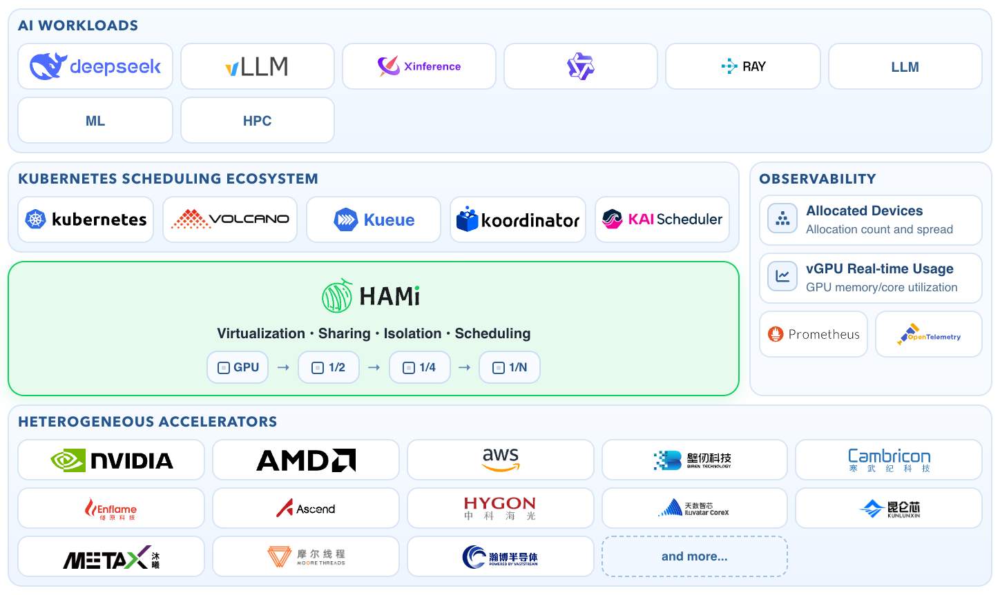

<picture>
  <source media="(prefers-color-scheme: dark)" srcset="imgs/hami-horizontal-color-white.svg">
  
</picture>

**Kubernetes GPU virtualization and heterogeneous accelerator scheduling for AI infrastructure.**

 

English version | [中文版](README_cn.md) | [日本語版](README_ja.md)

<picture>
  <source media="(prefers-color-scheme: dark)" srcset="imgs/hami-architecture-dark.png">
  
</picture>

HAMi stands for **Heterogeneous AI Computing Virtualization Middleware**. Formerly known as `k8s-vGPU-scheduler`, HAMi helps platform teams share expensive GPUs and other AI accelerators across Kubernetes workloads, isolate device memory and compute, and schedule pods with device-aware policies without changing application code.

HAMi is a [CNCF Incubating](https://www.cncf.io/projects/hami/) and [CNCF Landscape](https://landscape.cncf.io/?item=orchestration-management--scheduling-orchestration--hami) project. It is also listed in the [CNAI Landscape](https://landscape.cncf.io/?group=cnai&item=cnai--general-orchestration--hami).

<picture>
  <source media="(prefers-color-scheme: dark)" srcset="imgs/cncf-color-whitetext.svg">
  
</picture>

## Documentation

| Get started | Configure and integrate | Observe and maintain |
| --- | --- | --- |
| [Architecture](https://project-hami.io/docs/next/core-concepts/architecture) | [Configuration and operations](https://project-hami.io/docs/next/userguide/configure) | [Device allocation metrics](https://project-hami.io/docs/next/userguide/monitoring/device-allocation) |
| [GPU virtualization](https://project-hami.io/docs/next/core-concepts/gpu-virtualization) | [NVIDIA scheduling policies](https://project-hami.io/docs/next/userguide/nvidia-device/scheduling-policy) | [Device usage metrics](https://project-hami.io/docs/next/userguide/monitoring/real-time-device-usage) |
| [Supported devices and vendor guides](https://project-hami.io/docs/next/userguide/device-supported) | [NVIDIA dynamic MIG](https://project-hami.io/docs/next/userguide/nvidia-device/dynamic-mig-support) | [Grafana dashboards](https://project-hami.io/docs/next/userguide/monitoring/grafana-dashboard) |
| [Prerequisites](https://project-hami.io/docs/next/installation/prerequisites) | [Volcano integration](https://project-hami.io/docs/next/installation/how-to-use-volcano-vgpu) | [WebUI](https://project-hami.io/docs/next/userguide/hami-webui-user-guide) |
| [Install and run a first workload](https://project-hami.io/docs/next/get-started/deploy-with-helm) | [Kueue integration](https://project-hami.io/docs/next/userguide/kueue/how-to-use-kueue) | [Upgrade and migrate values](https://project-hami.io/docs/next/installation/upgrade) |
| [Benchmarks](https://project-hami.io/docs/next/userguide/benchmark) |  | [Troubleshooting](https://project-hami.io/docs/next/troubleshooting) |
|  |  | [Uninstall](https://project-hami.io/docs/next/installation/uninstall) |

## Repository resources

- [Chart values reference](charts/hami/README.md)
- [Workload examples](examples/)
- [Agent skills](skill/)
- [HAMi-WebUI repository](https://github.com/Project-HAMi/HAMi-WebUI)

## Roadmap, Governance, and Contributing

Planned work for each release is tracked in the [roadmap issues](https://github.com/Project-HAMi/HAMi/issues?q=is%3Aissue%20label%3Akind%2Ffeature%20in%3Atitle%20roadmap%20sort%3Acreated-desc).

HAMi is governed by [maintainers](./MAINTAINERS.md) and [contributors](./AUTHORS.md). Governance is described in the [HAMi community repository](https://github.com/Project-HAMi/community/blob/main/governance.md).

To contribute code, documentation, tests, or device backend improvements, read [CONTRIBUTING.md](./CONTRIBUTING.md).

## Community

- [HAMi community page](https://project-hami.io/community): chat channels, mailing lists, meeting schedules, and meeting notes
- [Slack](https://cloud-native.slack.com/archives/C07T10BU4R2) and [Discord](https://discord.com/invite/Amhy7XmbNq)
- [Talk materials](https://github.com/Project-HAMi/community/tree/main/talks)

## License

HAMi is licensed under the Apache License 2.0. See [LICENSE](LICENSE) for details.

Copyright Contributors to HAMi, established as HAMi a Series of LF Projects, LLC.
