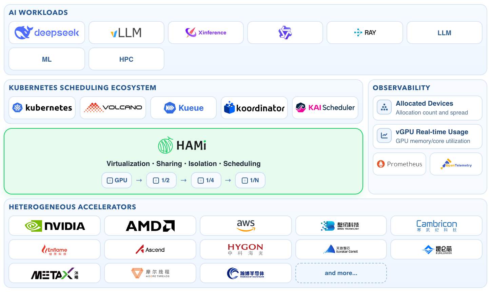

<picture>
  <source media="(prefers-color-scheme: dark)" srcset="imgs/hami-horizontal-color-white.svg">
  
</picture>

**Kubernetes GPU 虚拟化与异构加速器调度，面向 AI 基础设施。**

 

[English version](README.md) | 中文版 | [日本語版](README_ja.md)

<picture>
  <source media="(prefers-color-scheme: dark)" srcset="imgs/hami-architecture-dark.png">
  
</picture>

HAMi 全称**异构 AI 计算虚拟化中间件**（Heterogeneous AI Computing Virtualization Middleware）。前身为 `k8s-vGPU-scheduler`，HAMi 帮助平台团队在 Kubernetes 工作负载间共享昂贵的 GPU 及其他 AI 加速器，隔离设备显存和算力，并通过设备感知的调度策略调度 Pod，无需修改应用代码。

HAMi 是 [CNCF Incubating](https://www.cncf.io/projects/hami/) 和 [CNCF Landscape](https://landscape.cncf.io/?item=orchestration-management--scheduling-orchestration--hami) 项目，同时也被列入 [CNAI Landscape](https://landscape.cncf.io/?group=cnai&item=cnai--general-orchestration--hami)。

<picture>
  <source media="(prefers-color-scheme: dark)" srcset="imgs/cncf-color-whitetext.svg">
  
</picture>

## 文档

| 快速开始 | 配置与集成 | 观测与维护 |
| --- | --- | --- |
| [架构](https://project-hami.io/zh/docs/next/core-concepts/architecture) | [配置与运维](https://project-hami.io/zh/docs/next/userguide/configure) | [设备分配指标](https://project-hami.io/zh/docs/next/userguide/monitoring/device-allocation) |
| [GPU 虚拟化](https://project-hami.io/zh/docs/next/core-concepts/gpu-virtualization) | [NVIDIA 调度策略](https://project-hami.io/zh/docs/next/userguide/nvidia-device/scheduling-policy) | [设备使用指标](https://project-hami.io/zh/docs/next/userguide/monitoring/real-time-device-usage) |
| [支持的设备与厂商指南](https://project-hami.io/zh/docs/next/userguide/device-supported) | [NVIDIA 动态 MIG](https://project-hami.io/zh/docs/next/userguide/nvidia-device/dynamic-mig-support) | [Grafana 仪表盘](https://project-hami.io/zh/docs/next/userguide/monitoring/grafana-dashboard) |
| [前置条件](https://project-hami.io/zh/docs/next/installation/prerequisites) | [Volcano 集成](https://project-hami.io/zh/docs/next/installation/how-to-use-volcano-vgpu) | [WebUI](https://project-hami.io/zh/docs/next/userguide/hami-webui-user-guide) |
| [安装并运行首个工作负载](https://project-hami.io/zh/docs/next/get-started/deploy-with-helm) | [Kueue 集成](https://project-hami.io/zh/docs/next/userguide/kueue/how-to-use-kueue) | [升级与参数迁移](https://project-hami.io/zh/docs/next/installation/upgrade) |
| [性能测试](https://project-hami.io/zh/docs/next/userguide/benchmark) |  | [故障排查](https://project-hami.io/zh/docs/next/troubleshooting) |
|  |  | [卸载](https://project-hami.io/zh/docs/next/installation/uninstall) |

## 仓库资源

- [Chart 完整参数参考](charts/hami/README.md)
- [工作负载示例](examples/)
- [Agent skills](skill/)
- [HAMi-WebUI 仓库](https://github.com/Project-HAMi/HAMi-WebUI)

## 路线图、治理与贡献

每个版本的计划工作记录在[路线图 issue](https://github.com/Project-HAMi/HAMi/issues?q=is%3Aissue%20label%3Akind%2Ffeature%20in%3Atitle%20roadmap%20sort%3Acreated-desc)中。

HAMi 由[维护者](./MAINTAINERS.md)和[贡献者](./AUTHORS.md)共同治理。治理规则详见 [HAMi 社区仓库](https://github.com/Project-HAMi/community/blob/main/governance.md)。

如需贡献代码、文档、测试或设备后端改进，请阅读 [CONTRIBUTING.md](./CONTRIBUTING.md)。

## 社区

- [HAMi 社区页面](https://project-hami.io/zh/community)：交流渠道、邮件列表、会议安排及纪要
- [Slack](https://cloud-native.slack.com/archives/C07T10BU4R2) 和 [Discord](https://discord.com/invite/Amhy7XmbNq)
- [演讲资料](https://github.com/Project-HAMi/community/tree/main/talks)

## 许可证

HAMi 采用 Apache License 2.0 许可证。详见 [LICENSE](LICENSE)。

Copyright Contributors to HAMi, established as HAMi a Series of LF Projects, LLC.
