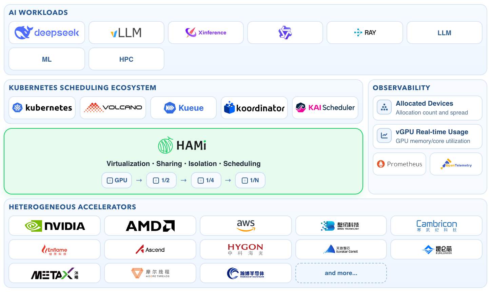

<picture>
  <source media="(prefers-color-scheme: dark)" srcset="imgs/hami-horizontal-color-white.svg">
  
</picture>

**AI インフラストラクチャ向け Kubernetes GPU 仮想化およびヘテロジニアスアクセラレータスケジューリング。**

 

[English version](README.md) | [中文版](README_cn.md) | 日本語版

<picture>
  <source media="(prefers-color-scheme: dark)" srcset="imgs/hami-architecture-dark.png">
  
</picture>

HAMi は **Heterogeneous AI Computing Virtualization Middleware**（異種 AI コンピューティング仮想化ミドルウェア）の略称です。旧称 `k8s-vGPU-scheduler`。HAMi はプラットフォームチームが Kubernetes ワークロード間で高価な GPU やその他の AI アクセラレータを共有し、デバイスメモリとコンピュートを分離し、アプリケーションコードを変更することなくデバイスアウェアなスケジューリングポリシーで Pod をスケジュールできるようにします。

HAMi は [CNCF Incubating](https://www.cncf.io/projects/hami/) および [CNCF Landscape](https://landscape.cncf.io/?item=orchestration-management--scheduling-orchestration--hami) プロジェクトであり、[CNAI Landscape](https://landscape.cncf.io/?group=cnai&item=cnai--general-orchestration--hami) にも掲載されています。

<picture>
  <source media="(prefers-color-scheme: dark)" srcset="imgs/cncf-color-whitetext.svg">
  
</picture>

## ドキュメント

| はじめに | 設定と連携 | 監視と運用 |
| --- | --- | --- |
| [アーキテクチャ](https://project-hami.io/docs/next/core-concepts/architecture) | [設定と運用](https://project-hami.io/docs/next/userguide/configure) | [デバイス割り当てメトリクス](https://project-hami.io/docs/next/userguide/monitoring/device-allocation) |
| [GPU 仮想化](https://project-hami.io/docs/next/core-concepts/gpu-virtualization) | [NVIDIA スケジューリングポリシー](https://project-hami.io/docs/next/userguide/nvidia-device/scheduling-policy) | [デバイス使用状況のメトリクス](https://project-hami.io/docs/next/userguide/monitoring/real-time-device-usage) |
| [対応デバイスとベンダー別ガイド](https://project-hami.io/docs/next/userguide/device-supported) | [NVIDIA ダイナミック MIG](https://project-hami.io/docs/next/userguide/nvidia-device/dynamic-mig-support) | [Grafana ダッシュボード](https://project-hami.io/docs/next/userguide/monitoring/grafana-dashboard) |
| [前提条件](https://project-hami.io/docs/next/installation/prerequisites) | [Volcano 連携](https://project-hami.io/docs/next/installation/how-to-use-volcano-vgpu) | [WebUI](https://project-hami.io/docs/next/userguide/hami-webui-user-guide) |
| [インストールと最初のワークロード](https://project-hami.io/docs/next/get-started/deploy-with-helm) | [Kueue 連携](https://project-hami.io/docs/next/userguide/kueue/how-to-use-kueue) | [アップグレードと設定の移行](https://project-hami.io/docs/next/installation/upgrade) |
| [ベンチマーク](https://project-hami.io/docs/next/userguide/benchmark) |  | [トラブルシューティング](https://project-hami.io/docs/next/troubleshooting) |
|  |  | [アンインストール](https://project-hami.io/docs/next/installation/uninstall) |

## リポジトリのリソース

- [Chart の設定値一覧](charts/hami/README.md)
- [ワークロードの例](examples/)
- [Agent skills](skill/)
- [HAMi-WebUI リポジトリ](https://github.com/Project-HAMi/HAMi-WebUI)

## ロードマップ、ガバナンス、コントリビューション

各リリースの計画は[ロードマップ issue](https://github.com/Project-HAMi/HAMi/issues?q=is%3Aissue%20label%3Akind%2Ffeature%20in%3Atitle%20roadmap%20sort%3Acreated-desc)で管理されています。

HAMi は[メンテナー](./MAINTAINERS.md)と[コントリビューター](./AUTHORS.md)によって管理されています。ガバナンスについては、[HAMi コミュニティリポジトリ](https://github.com/Project-HAMi/community/blob/main/governance.md)を参照してください。

コード、ドキュメント、テスト、デバイスバックエンドの改善に貢献するには、[CONTRIBUTING.md](./CONTRIBUTING.md) をお読みください。

## コミュニティ

- [HAMi コミュニティページ（英語）](https://project-hami.io/community)：チャット、メーリングリスト、ミーティングの予定と議事録
- [Slack](https://cloud-native.slack.com/archives/C07T10BU4R2) と [Discord](https://discord.com/invite/Amhy7XmbNq)
- [講演資料](https://github.com/Project-HAMi/community/tree/main/talks)

## ライセンス

HAMi は Apache License 2.0 の下でライセンスされています。詳細は [LICENSE](LICENSE) を参照してください。

Copyright Contributors to HAMi, established as HAMi a Series of LF Projects, LLC.
