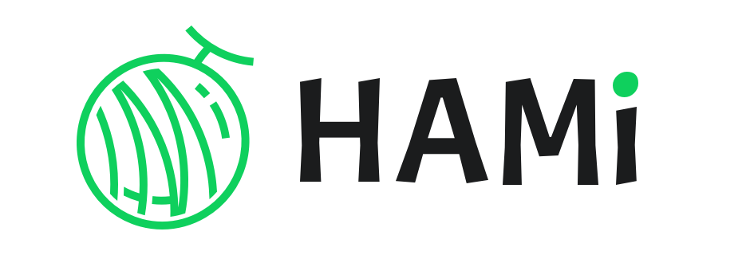
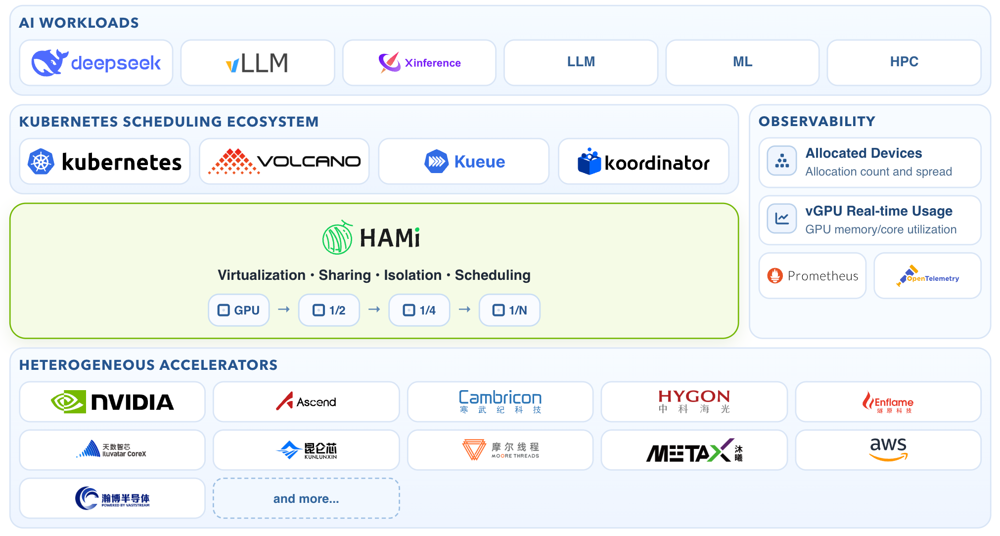

[English version](README.md) | [中文版](README_cn.md) | 日本語版

# HAMi

**AI インフラストラクチャ向け Kubernetes GPU 仮想化およびヘテロジニアスアクセラレータスケジューリング。**

HAMi は **Heterogeneous AI Computing Virtualization Middleware**（異種 AI コンピューティング仮想化ミドルウェア）の略称です。旧称 `k8s-vGPU-scheduler`。HAMi はプラットフォームチームが Kubernetes ワークロード間で高価な GPU やその他の AI アクセラレータを共有し、デバイスメモリとコンピュートを分離し、アプリケーションコードを変更することなくデバイスアウェアなスケジューリングポリシーで Pod をスケジュールできるようにします。

HAMi は [CNCF Incubating](https://www.cncf.io/projects/) および [CNCF Landscape](https://landscape.cncf.io/?item=orchestration-management--scheduling-orchestration--hami) プロジェクトであり、[CNAI Landscape](https://landscape.cncf.io/?group=cnai&item=cnai--general-orchestration--hami) にも掲載されています。

## ドキュメント

- [アーキテクチャ](https://project-hami.io/docs/next/core-concepts/architecture)
- [GPU 仮想化](https://project-hami.io/docs/next/core-concepts/gpu-virtualization)
- [対応デバイスとベンダー別ガイド](https://project-hami.io/docs/next/userguide/device-supported)
- [前提条件](https://project-hami.io/docs/next/installation/prerequisites)
- [インストールと最初のワークロード](https://project-hami.io/docs/next/get-started/deploy-with-helm)
- [アップグレードと設定の移行](https://project-hami.io/docs/next/installation/upgrade)
- [設定と運用](https://project-hami.io/docs/next/userguide/configure)
- [NVIDIA スケジューリングポリシー](https://project-hami.io/docs/next/userguide/nvidia-device/scheduling-policy)
- [NVIDIA ダイナミック MIG](https://project-hami.io/docs/next/userguide/nvidia-device/dynamic-mig-support)
- [デバイス割り当てメトリクス](https://project-hami.io/docs/next/userguide/monitoring/device-allocation)
- [デバイス使用状況のメトリクス](https://project-hami.io/docs/next/userguide/monitoring/real-time-device-usage)
- [Grafana ダッシュボード](https://project-hami.io/docs/next/userguide/monitoring/grafana-dashboard)
- [WebUI](https://project-hami.io/docs/next/userguide/hami-webui-user-guide)
- [Volcano 連携](https://project-hami.io/docs/next/installation/how-to-use-volcano-vgpu)
- [Kueue 連携](https://project-hami.io/docs/next/userguide/kueue/how-to-use-kueue)
- [ベンチマーク](https://project-hami.io/docs/next/userguide/benchmark)
- [トラブルシューティング](https://project-hami.io/docs/next/troubleshooting)
- [アンインストール](https://project-hami.io/docs/next/installation/uninstall)

## リポジトリのリソース

- [Chart の設定値一覧](charts/hami/README.md)
- [ワークロードの例](examples/)
- [Agent skills](skill/)
- [HAMi-WebUI リポジトリ](https://github.com/Project-HAMi/HAMi-WebUI)

## ロードマップ、ガバナンス、コントリビューション

HAMi は[メンテナー](./MAINTAINERS.md)と[コントリビューター](./AUTHORS.md)によって管理されています。ガバナンスについては、[HAMi コミュニティリポジトリ](https://github.com/Project-HAMi/community/blob/main/governance.md)を参照してください。

コード、ドキュメント、テスト、デバイスバックエンドの改善に貢献するには、[CONTRIBUTING.md](./CONTRIBUTING.md) をお読みください。

## コミュニティ

チャット、メーリングリスト、ミーティングの予定と議事録は [HAMi コミュニティページ（英語）](https://project-hami.io/community)を参照してください。

[講演資料](https://github.com/Project-HAMi/community/tree/main/talks)

## ライセンス

HAMi は Apache License 2.0 の下でライセンスされています。詳細は [LICENSE](LICENSE) を参照してください。

Copyright Contributors to HAMi, established as HAMi a Series of LF Projects, LLC.
